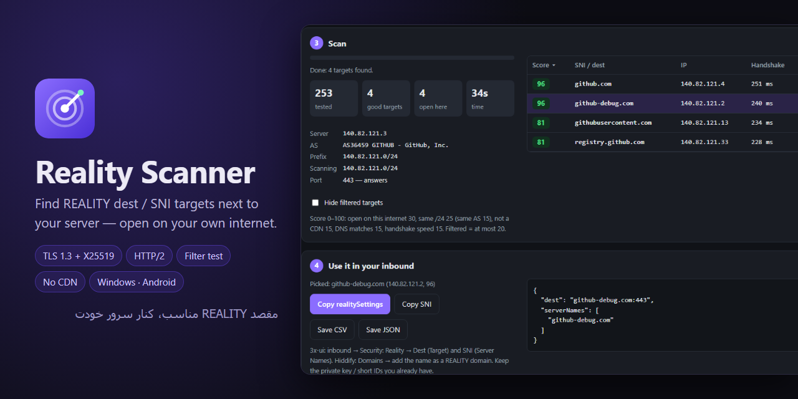

<p align="center"></p>

<h1 align="center">Reality Scanner</h1>

<p align="center"><a href="https://hits.sh/github.com/Plus98ir/Reality-Scanner/"></a> <a href="https://corenetbase.com/#support"></a></p>

<details>
<summary><b>☕ Support · حمایت</b> — USDT (TRC20) / TRX</summary>
<br>
<p align="center"></p>

```
TA53aFyGNfSAcrCaJi9QmA9x5W47nPJcf7
```

> [!WARNING]
> **TRON network only.** Sending from ERC20 / BEP20 will lose the funds.<br>
> **فقط شبکه‌ی TRON.** ارسال از ERC20 یا BEP20 پول را از بین می‌برد.

</details>

<div align="center">

[ &nbsp;**English**](README.md) &nbsp;&nbsp;|&nbsp;&nbsp; [ &nbsp;**فارسی**](README.fa.md)

</div>

<div dir="rtl">

**Reality Scanner** برای سرور Xray شما مقصد مناسب REALITY (یعنی `dest` و `serverNames`) پیدا می‌کند و چک می‌کند که روی **اینترنت خود شما** فیلتر نباشد.

برنامه را روی کامپیوتر یا گوشی، با همان اینترنتی که کاربرانتان دارند و با VPN خاموش اجرا کنید. IP سرور و پورت REALITY را بدهید و **شروع اسکن** را بزنید:

۱. گواهی IPهای کنار سرور را می‌خواند و اسم سایت‌ها را از آن درمی‌آورد.
۲. هر اسم را مثل Xray چک می‌کند: TLS 1.3، X25519، HTTP/2 و گواهی معتبر.
۳. اسم را به‌عنوان SNI از اینترنت شما به سرور خودتان می‌فرستد. اگر اپراتور قطعش کند، **فیلتر** علامت می‌خورد.
۴. به بقیه امتیاز می‌دهد و یک `realitySettings` آماده برای کپی تحویل می‌دهد.

دانلود: [ویندوز (exe)](https://github.com/Plus98ir/Reality-Scanner/releases/latest/download/Reality-Scanner.exe) · [اندروید (apk)](https://github.com/Plus98ir/Reality-Scanner/releases/latest/download/Reality-Scanner.apk)

</div>
