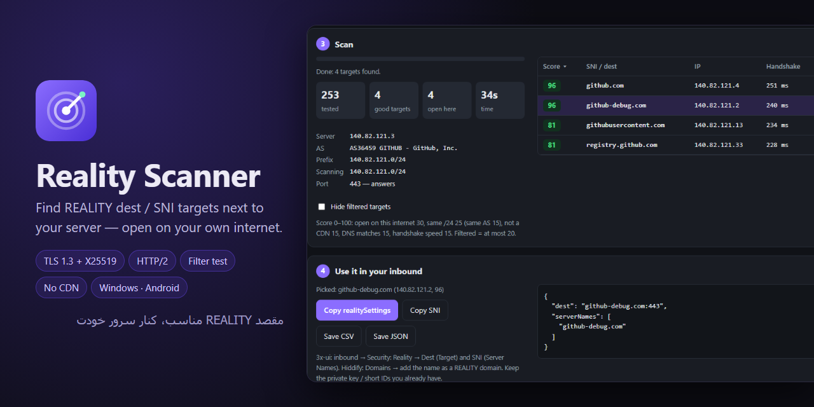

# Reality Scanner

Finds good **Xray REALITY** targets (`dest` / `serverNames`) for your server, and checks that they are open on **your own internet**.

You run it on your PC or phone, on the same internet your users have (VPN off). Enter your server's IP and REALITY port, press **Start scan**:

1. It reads the certificate of every IP next to your server and takes the site names from it.
2. It checks each name the way Xray does: TLS 1.3, X25519, HTTP/2 and a valid certificate.
3. It sends the name as SNI to your own server from your internet. If your ISP cuts it, it is marked **filtered**.
4. It scores the rest (open, same /24 or AS, not a CDN, DNS match, fast handshake) and gives you a ready `realitySettings` block to copy.

You can also check your own list of domains instead of scanning IPs.

## Download

| Platform | File |
|---|---|
| Windows 10/11 | [Reality-Scanner.exe](https://github.com/Plus98ir/Reality-Scanner/releases/latest/download/Reality-Scanner.exe) — no Python needed |
| Android 7+ | [Reality-Scanner.apk](https://github.com/Plus98ir/Reality-Scanner/releases/latest/download/Reality-Scanner.apk) |

The app tells you when a new build is out.

---

## فارسی

**Reality Scanner** برای سرور Xray شما مقصد مناسب REALITY (یعنی `dest` و `serverNames`) پیدا می‌کند و چک می‌کند که روی **اینترنت خود شما** فیلتر نباشد.

برنامه را روی کامپیوتر یا گوشی، با همان اینترنتی که کاربرانتان دارند و با VPN خاموش اجرا کنید. IP سرور و پورت REALITY را بدهید و **شروع اسکن** را بزنید:

۱. گواهی IPهای کنار سرور را می‌خواند و اسم سایت‌ها را از آن درمی‌آورد.
۲. هر اسم را مثل Xray چک می‌کند: TLS 1.3، X25519، HTTP/2 و گواهی معتبر.
۳. اسم را به‌عنوان SNI از اینترنت شما به سرور خودتان می‌فرستد. اگر اپراتور قطعش کند، **فیلتر** علامت می‌خورد.
۴. به بقیه امتیاز می‌دهد و یک `realitySettings` آماده برای کپی تحویل می‌دهد.

دانلود: [ویندوز (exe)](https://github.com/Plus98ir/Reality-Scanner/releases/latest/download/Reality-Scanner.exe) · [اندروید (apk)](https://github.com/Plus98ir/Reality-Scanner/releases/latest/download/Reality-Scanner.apk)

